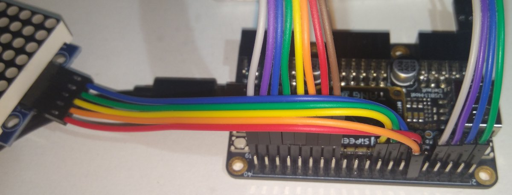
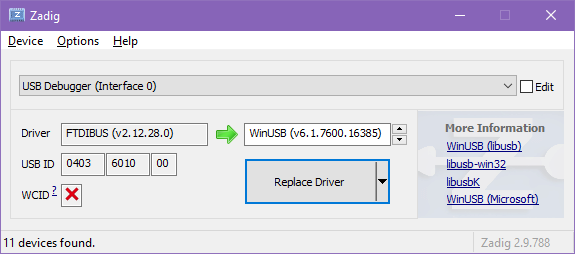
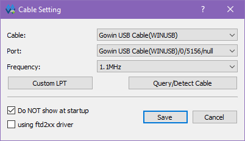

### Setting up the Tang Primer 25K FPGA with Gowin EDA Student Edition for the E80 Toolchain

1. Install [Gowin EDA Student Edition](https://eda.gowinsemi.cn/Gowin_V1.9.11.03_Education_x64_win.zip)[^1] (also available on [Linux](https://eda.gowinsemi.cn/Gowin_V1.9.11.03_Education_Linux.tar.gz)[^2] and [MacOS](https://eda.gowinsemi.cn/Gowin_V1.9.11.03Education_macOS.dmg)[^3]).
2. Install the [latest version of the toolchain](https://github.com/Stokpan/E80/releases) and navigate to its folder.
3. Open `Boards\Gowin_TangPrimer25K\E80.cst` in a text editor and connect the components according to the Pin Assignments section.
    
    
   _Pin #11 of the top 2x20 vertical header provides 5V output, matching the requirements of the 4x8x8 LED module._
4. Open the `Boards\Gowin_TangPrimer25K\Gowin.gprj` project file in Gowin.
5. Compile the project using Run All and connect your Tang Primer 25K board to your PC.
6. When the compilation is finished use the Programmer function (click on USB Cable Setting > Save, and then click on Program/Configure) to upload the bitstream. You may need to click multiple times on Program/Configure.
7. The precompiled `hello.e80asm` program will be loaded with speed level set to 0; use the Right button to increase speed, or Set for step execution, until the Halt flag is set (matrix 1, row 7, rightmost LED).
8. (Optional) I've found that the WinUSB Driver offered by [Zadig](https://github.com/pbatard/libwdi/releases/download/v1.5.1/zadig-2.9.exe)[^4] flashes more reliably. Click Options > List All Devices and select "USB Debugger (Interface 0)". Make sure the USB ID is 0403 6010 00 as in the following screenshot:
	 
	 Click Replace Driver and wait (patiently) until Zadig reports success. Then open the Cable Setting at the Gowin Programmer, uncheck ftd2xx driver and click Query/Detect Cable. You should see the following:
	 
	 Step 6 will now be working better (Program/Configure should always work).

[^1]: SHA256:99f339ada2104b9b7f19cfded2b6d6f223038f61e8c6a0adae8631d30c5e6fe6
[^2]: SHA256:6fd392f7473b24d847b6f8ebdc7a185c591826ba35d8d0e517961030d446f9f7
[^3]: SHA256:95efaf06e4df1d902ec3307ce5e52fceb76cf5937b0eae5001555df94330c500
[^4]: SHA256:4ecaa95df3da3621486a043aef8b3050b8bafe7c901402871e816229ef82039b