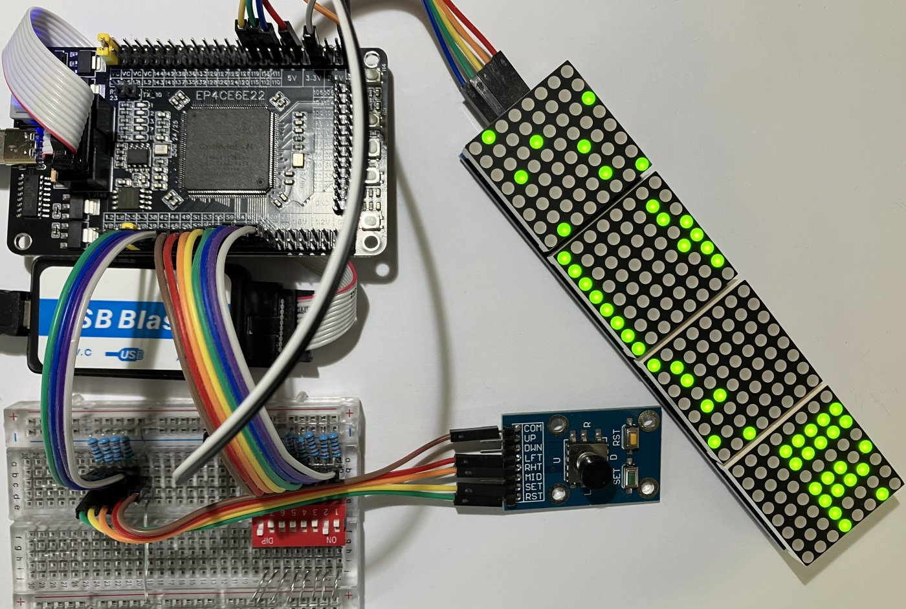

### Setting up a generic Cyclone IV FPGA board with Quartus for the E80 Toolchain

This is a [low-cost](https://www.aliexpress.com/item/1005009825630078.html) (€10) Cyclone IV board with no markings other than "EP4CE6E22". Some documentation is provided by [Rawat Siripokarpirom's blog](https://iot-kmutnb.github.io/blogs/fpga/fpga_ep4ce6_board/) and an [EEVblog forum thread](https://www.eevblog.com/forum/projects/schematic-for-ep4ce6e22c8n-dev-board/). It needs two USB connections to be programmed: one (USB-C) that provides power and serial communication, and another through a [USB Blaster](https://www.aliexpress.com/item/1005009245070868.html) (€4.5) connected to the JTAG socket for uploading the bitstream.

I've tested this board with various free versions of Quartus from 13.1 to 25.1. All work fine on Windows 10 and 11, with two caveats: v20.1's Blaster driver signature has expired, and v25.1's simulator requires a license renewal every year. I found [v13.1](https://download.altera.com/akdlm/software/acdsinst/13.1/162/ib_tar/Quartus-web-13.1.0.162-windows.tar)[^1] to be particularly interesting: it provides a 32bit option that I tested on a Windows 11 VirtualBox, using the Guest Additions USB bridge for the Blaster device, and the time required for compilation was ~1'40" (compared to ~1'10" on my PC) with 660MB peak Virtual Memory only (compared to ~5GB for all other versions).

1. Install Quartus.
2. Connect the USB Blaster to your computer, open the Device Manager, and check that _"Altera USB-Blaster"_ shows under Universal Serial Bus controllers. If it shows as _"USB-Blaster"_ under _Other devices_, update its driver from the `quartus\drivers\usb-blaster` folder of the Quartus installation.
3. Install the [latest version of the toolchain](https://github.com/Stokpan/E80/releases) and navigate to its folder.
4. Open `Boards\Quartus_CycloneIV\E80.qsf` in a text editor and connect the components according to the Pin Assignments section and the photo below.
    
    _The generic Cyclone board connected with both USB-C for power and the USB Blaster interface. Both yellow jumpers must be set to 3.3, as shown._
5. Open the `Boards\Quartus_CycloneIV\E80.qpf` project file in Quartus and hit Ctrl-L to start compilation.
6. Power the board (blue light on), and connect the USB Blaster to its JTAG header.
7. Open Tools > Programmer, click Hardware Setup and select USB-Blaster.
8. With Mode set to JTAG and `output_files/E80.sof` already selected, click Start.

The precompiled `hello.e80asm` program will start running with speed level set to 2 (~1 Hz) until the Halt flag is set (matrix 1, row 7, rightmost LED). Use the Reset button to restart the program, Left and Right to control speed level, and Pause for step execution (if speed is set to 0).

The program is cleared when the board is powered off; to retain it on the flash memory:

1. Click on the auto-added `output_files/E80.sof` entry and delete it.
2. Add File > `output_files/E80.jic`.
3. Click on the EPCS4 device Program/Configure checkbox; this should auto-check EP4CE6 device's checkbox as well.
4. Click Start and wait for the Progress bar to reach 100%.
5. Power off the board.

From now on, when you power on the board your program should automatically start. To clear the board, click on Erase instead of Program/Configure in step #3.

[^1]: SHA256:66f6338747ac56313dbd9b0563728164240e80206e3c575c216e282c5554ca09