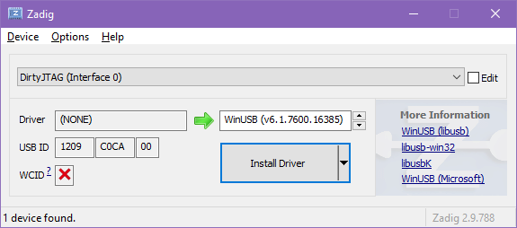
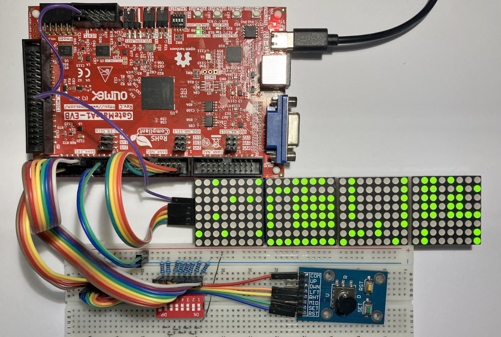
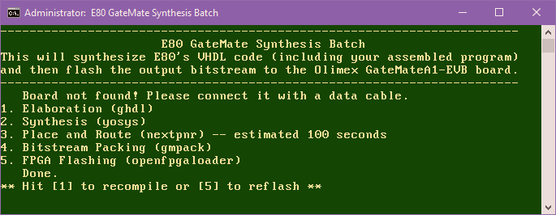

### Setting up the GateMateA1-EVB FPGA with the OSS CAD Suite for the E80 Toolchain

This is a [low-cost](https://www.olimex.com/Products/FPGA/GateMate/GateMateA1-EVB/open-source-hardware) (€50) open-source hardware board with a Cologne Chip GateMate A1 FPGA. A USB port provides power and the programming interface.

1. Install the [latest version of the toolchain](https://github.com/Stokpan/E80/releases) and navigate to its folder.
2. Download the OSS CAD Suite for Windows (I prefer [version 2026-07-27](https://github.com/YosysHQ/oss-cad-suite-build/releases/download/2026-07-27/oss-cad-suite-windows-x64-20260727.exe)[^1]) and run it on the toolchain folder so that it extracts its `oss-cad-suite` folder there.
3. To install the USB driver for the board, connect it to your computer, download and run [Zadig](https://github.com/pbatard/libwdi/releases/download/v1.5.1/zadig-2.9.exe)[^2], and check that it shows the same device:
	 
	 Click Install Driver and wait (patiently) until Zadig reports success.
4. Open `Boards\Yosys_GateMateA1\E80.ccf` in a text editor and connect the components according to the Pin Assignments section and the photo below.
    
    _The LED module requires a 5V VCC input at 330mA. For my testing purposes, I connected it to the 3.3V pin #1 in UEXT1, but it's best to use a dedicated supply instead._
5. Run the _GateMate Synthesis Batch_ from the E80 Toolchain folder on the Start Menu and wait until all steps, from elaboration to flashing, are finished:
    
    _The batch checks for the OSS CAD Suite, cable connection, board driver, and an existing bitstream. Nextpnr's duration is estimated by sampling steps 1 & 2 and multiplying by 10 -- not quite accurate._

The precompiled `hello.e80asm` program will start running with speed level set to 2 (~1 Hz) until the Halt flag is set (matrix 1, row 7, rightmost LED). Use the Reset button to restart the program, Left and Right to control speed level, and Pause for step execution (if speed is set to 0).

[^1]: SHA256:11940b24a859786fb44754f2a19036d2926f27ba753cc9ac2e0caa26f619a4b3
[^2]: SHA256:4ecaa95df3da3621486a043aef8b3050b8bafe7c901402871e816229ef82039b