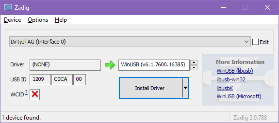
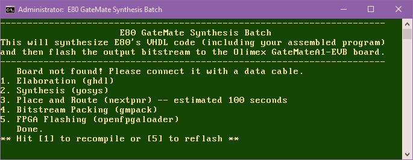

### Setting up the GateMateA1-EVB FPGA with the OSS CAD Suite for the E80 Toolchain

1. Install the [latest version of the toolchain](https://github.com/Stokpan/E80/releases) and navigate to its folder.
2. Download the OSS CAD Suite for Windows (I prefer [version 2026-07-27](https://github.com/YosysHQ/oss-cad-suite-build/releases/download/2026-07-27/oss-cad-suite-windows-x64-20260727.exe)[^1]) and run it on the toolchain folder; it will extract its oss-cad-suite folder there.
3. To install the USB driver for the board, connect it to your computer and download and run [Zadig](https://github.com/pbatard/libwdi/releases/download/v1.5.1/zadig-2.9.exe)[^2]. Make sure you see the same with this screenshot:
	 
	 Click Install Driver and wait (patiently) until Zadig reports success.
4. Open `Boards\Yosys_GateMateA1\E80.ccf` in a text editor and connect the components according to the Pin Assignments section.
    
    _The LED module requires a 5V VCC input at 330mA. For my testing purposes, I connected it to the 3.3V pin #1 in UEXT1, but it's best to use a dedicated supply instead._
5. Run the _GateMate Synthesis Batch_ from the E80 Toolchain folder on the Start Menu and wait until all steps, from elaboration to flashing, are finished:
    
    _The batch checks for the OSS CAD Suite, cable connection, board driver, and an existing bitstream. Nextpnr's duration is estimated by sampling steps 1 & 2 and multiplying by 10 -- not quite accurate._
6. The precompiled `hello.e80asm` program will be loaded with speed level set to 0; use the Right button to increase speed, or Set for step execution, until the Halt flag is set (matrix 1, row 7, rightmost LED).

[^1]: SHA256:11940b24a859786fb44754f2a19036d2926f27ba753cc9ac2e0caa26f619a4b3
[^2]: SHA256:4ecaa95df3da3621486a043aef8b3050b8bafe7c901402871e816229ef82039b