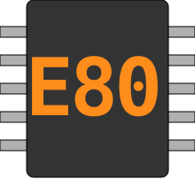
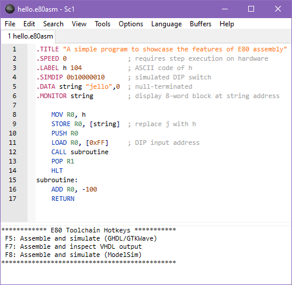
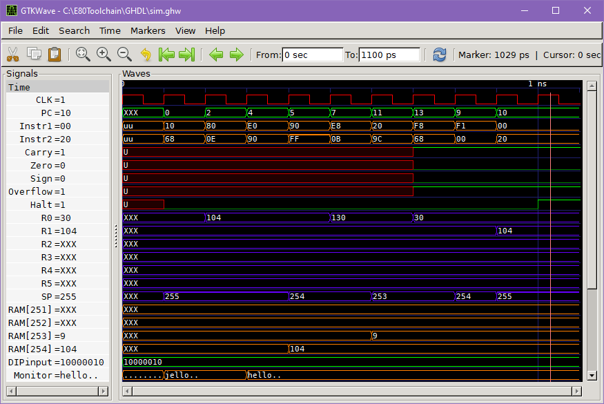
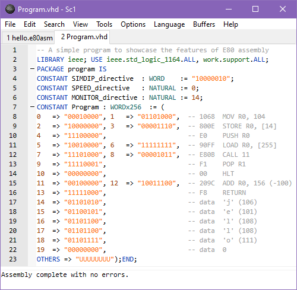
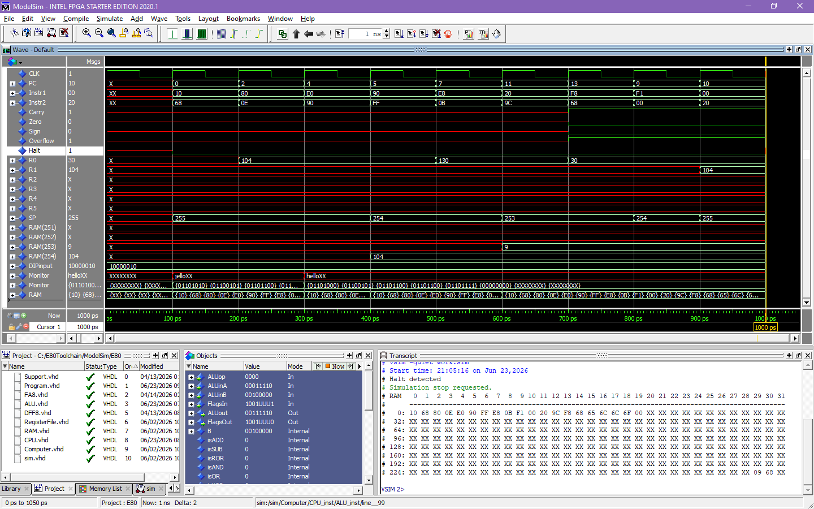
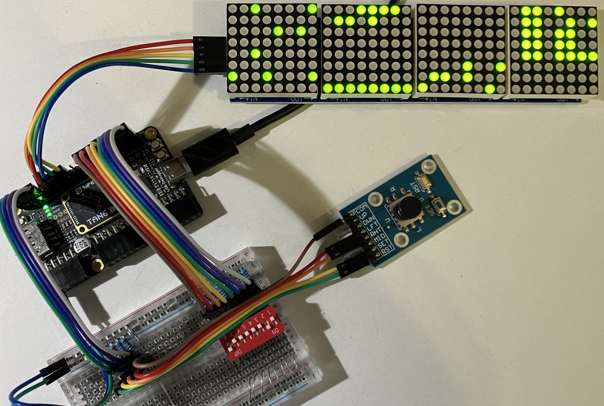
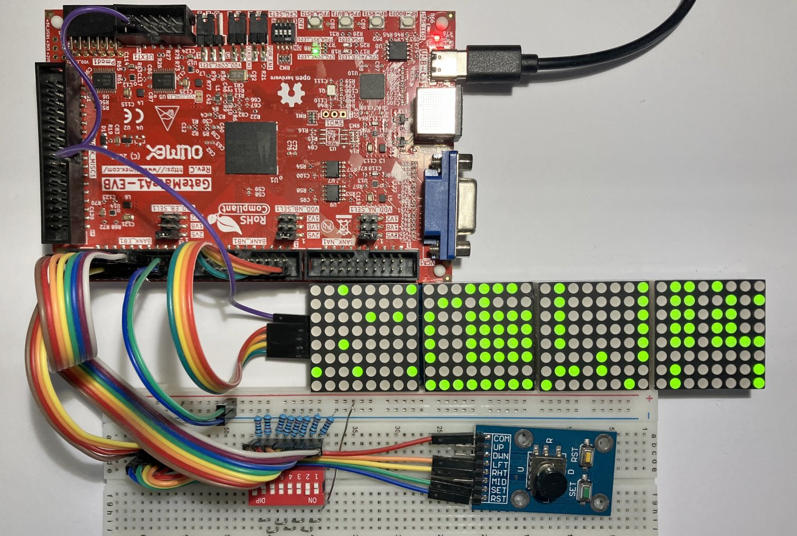
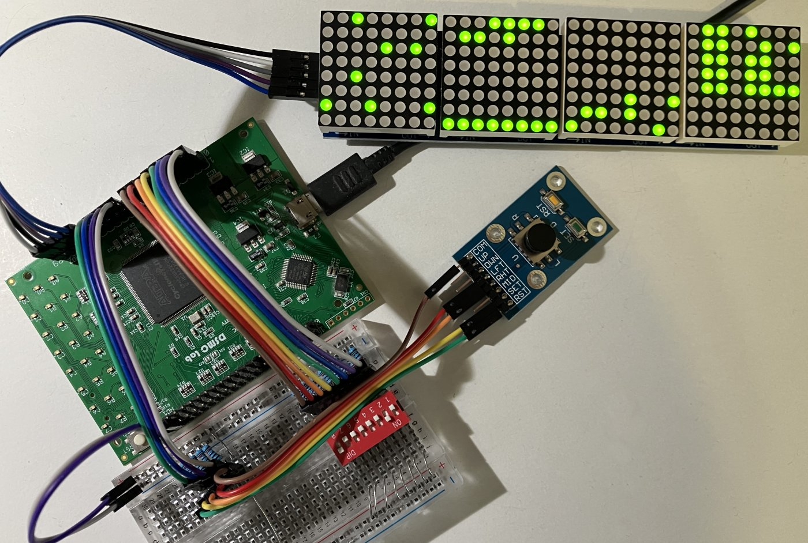
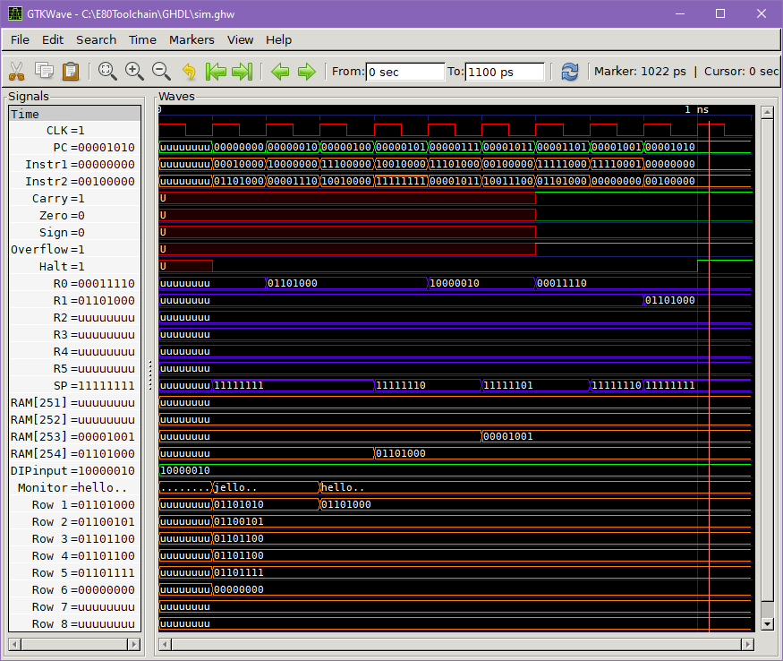
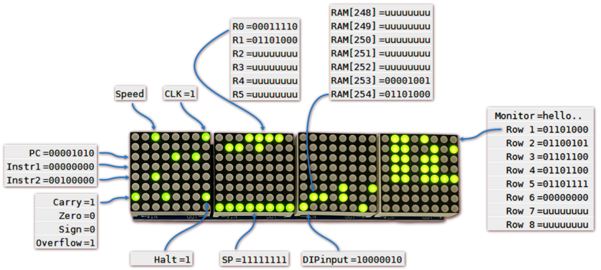

<a href="#"></a> is a simple computer developed as a Papertian Microworld. It provides a textbook-complete instruction set, a toolchain for one-click assembly and simulation, and a hardware interface with presets for three low-cost FPGA boards. The CPU is built in _gate-transparent_ VHDL corresponding to textbook logic diagrams without behavioral abstractions or arithmetic packages. This allows a student versed in elementary digital logic to understand and modify the microworld's _Object‑to‑think‑with_ instead of treating it as a black box. The project was originally developed for [my undergraduate thesis](https://apothesis.eap.gr/archive/item/222454), presented at [PACET 2026](https://sites.google.com/g.upatras.gr/pacet2026) with a [paper on IEEE Xplore](https://doi.org/10.1109/PACET68758.2026.11498245), and extended as a [full article on Electronics](https://doi.org/10.3390/electronics15204625). The article explains the methodology and engineering, and formally defines _gate-transparency_.<br clear="left">

## Table of Contents

1. [Features](#features)
2. [Instruction Set Architecture](#instruction-set-architecture)
3. [Assembly Language](#assembly-language)
4. [Simulation Example](#simulation-example)
5. [Hardware Implementation](#hardware-implementation)
6. [Complete Workflow Example](#complete-workflow-example)

## Features

* **Architecture**: 8-bit word/address, von Neumann, Load/Store, single cycle
* **VHDL**: Gate-transparent for the CPU and its components, behavioral for the rest
* **Instruction set**: Derived from a survey of introductory assembly sources, variable size (1 or 2 words), up to 2 operands
* **Addressing**: Immediate, direct, register, register-indirect
* **Registers**: Six general-purpose (R0-R5), flags (R6), stack pointer (R7)
* **Flags**: Carry, Zero, Sign, and Overflow, each tested by conditional jumps; Halt stops execution and simulation
* **Memory**: One read/write and two read ports, addressable at 0x00-0xFE, reloaded from the assembled program on reset
* **Stack**: Full-descending, stack pointer initialized at 0xFF
* **I/O**: 8-bit DIP switch at 0xFF; four daisy-chained MAX7219 8×8 LED matrices on three pins
* **Execution controls**: Seven speed levels (0 Hz-4 kHz) on two buttons, pause with step execution, reset
* **Display**: Speed level (one-hot), clock, program counter, instruction, flags, registers, stack area, DIP input, and a configurable memory block
* **Assembly syntax**: Hybrid of ARM, x86, and textbook pseudocode
* **Assembler**: Written in ISO C99, using stdin/stdout/stderr only; emits a formatted and annotated Program.vhd package
* **Toolchain**: Based on the Sc1 editor with syntax coloring and Lua / batch scripts; F5 assembles and simulates in GHDL/GTKWave; F7 dumps Program.vhd; F8 assembles and simulates in ModelSim
* **Board presets**: Sipeed Tang Primer 25K (Gowin), HOU DSD-i1 Cyclone IV (Quartus), Olimex GateMateA1 (OSS CAD Suite, run by a custom script)
* **Verification**: ISA compliance suite (76 checks), nth Fibonacci with Dijkstra's recursive method, and the LC-3 textbook maze escape

## Instruction Set Architecture

```
Operands : n = 8-bit immediate value or direct memory address
           r, r1, r2 = 3-bit register address (R0 to R7)
           eg. MOV R5,110 = 00010rrr nnnnnnnn = 00010101 01101110 = 1rnn = 156E
[x]      : Memory at address x < 255, [255] = DIP input
PC       : Program counter, initialized to 0 on reset
SP       : Register R7, initialized to 255 on reset
           --SP Decrease SP by 1, and then read it
           SP++ Read SP, and then increase it by 1
Flags    : Register R6 = [CZSV---H] (see ALU.vhd)
           C = Carry out (unsigned arithmetic) or shifted-out bit
           Z = Zero, set to 1 when result is 0
           S = Sign, set to the most significant bit of the result
           V = Overflow (signed arithmetic), or sign bit flip in L/RSHIFT
           H = Halt flag, (freezes PC)

     +-------------------+-------+---------------+-----------------------+-------+
     | Instruction       | Hex   | Mnemonic      | Description           | Flags |
+----+-------------------+-------+---------------+-----------------------+-------+
| 1  | 00000000          | 00    | HLT           | PC ← PC               |     H |
| 2  | 00000001          | 01    | NOP           |                       |       |
| 3  | 00000010 nnnnnnnn | 02 nn | JMP n         | PC ← n                |       |
| 4  | 00000100 nnnnnnnn | 04 nn | JC n          | if C=1, PC ← n        |       |
| 5  | 00000101 nnnnnnnn | 05 nn | JNC n         | if C=0, PC ← n        |       |
| 6  | 00000110 nnnnnnnn | 06 nn | JZ n          | if Z=1, PC ← n        |       |
| 7  | 00000111 nnnnnnnn | 07 nn | JNZ n         | if Z=0, PC ← n        |       |
| 8  | 00001000 nnnnnnnn | 08 nn | JS n          | if S=1, PC ← n        |       |
| 9  | 00001001 nnnnnnnn | 09 nn | JNS n         | if S=0, PC ← n        |       |
| 10 | 00001010 nnnnnnnn | 0A nn | JV n          | if V=1, PC ← n        |       |
| 11 | 00001011 nnnnnnnn | 0B nn | JNV n         | if V=0, PC ← n        |       |
| 12 | 00010rrr nnnnnnnn | 1r nn | MOV r,n       | r ← n                 |       |
| 13 | 00011000 0rrr0rrr | 18 rr | MOV r1,r2     | r1 ← r2               |       |
| 14 | 00100rrr nnnnnnnn | 2r nn | ADD r,n       | r ← r+n               | CZSV  |
| 15 | 00101000 0rrr0rrr | 28 rr | ADD r1,r2     | r1 ← r1+r2            | CZSV  |
| 16 | 00110rrr nnnnnnnn | 3r nn | SUB r,n       | r ← r+(~n)+1          | CZSV  |
| 17 | 00111000 0rrr0rrr | 38 rr | SUB r1,r2     | r1 ← r1+(~r2)+1       | CZSV  |
| 18 | 01000rrr nnnnnnnn | 4r nn | AND r,n       | r ← r&n               |  ZS   |
| 19 | 01001000 0rrr0rrr | 48 rr | AND r1,r2     | r1 ← r1&r2            |  ZS   |
| 20 | 01010rrr nnnnnnnn | 5r nn | OR r,n        | r ← r|n               |  ZS   |
| 21 | 01011000 0rrr0rrr | 58 rr | OR r1,r2      | r1 ← r1|r2            |  ZS   |
| 22 | 01100rrr nnnnnnnn | 6r nn | XOR r,n       | r ← r^n               |  ZS   |
| 23 | 01101000 0rrr0rrr | 68 rr | XOR r1,r2     | r1 ← r1^r2            |  ZS   |
| 24 | 01110rrr nnnnnnnn | 7r nn | ROR r,n       | r>>n (r<<8-n)         |  ZS   |
| 25 | 01111000 0rrr0rrr | 78 rr | ROR r1,r2     | r1>>r2 (r1<<8-r2)     |  ZS   |
| 26 | 10000rrr nnnnnnnn | 8r nn | STORE r,[n]   | r → [n]               |       |
| 27 | 10001000 0rrr0rrr | 88 rr | STORE r1,[r2] | r1 → [r2]             |       |
| 28 | 10010rrr nnnnnnnn | 9r nn | LOAD r,[n]    | r ← [n]               |       |
| 29 | 10011000 0rrr0rrr | 98 rr | LOAD r1,[r2]  | r1 ← [r2]             |       |
| 30 | 10100rrr          | Ar    | LSHIFT r      | (C,r)<<1; V ← S flip  | CZSV  |
| 31 | 10110rrr nnnnnnnn | Br nn | CMP r,n       | SUB, discard result   | CZSV  |
| 32 | 10111000 0rrr0rrr | B8 rr | CMP r1,r2     | SUB, discard result   | CZSV  |
| 33 | 11000rrr nnnnnnnn | Cr nn | BIT r,n       | AND, discard result   |  ZS   |
| 34 | 11001000 0rrr0rrr | C8 rr | BIT r1,r2     | AND, discard result   |  ZS   |
| 35 | 11010rrr          | Dr    | RSHIFT r      | (r,C)>>1; V ← S flip  | CZSV  |
| 36 | 11100rrr          | Er    | PUSH r        | r → [--SP]            |       |
| 37 | 11101000 nnnnnnnn | E8 nn | CALL n        | PC+2 → [--SP]; PC ← n |       |
| 38 | 11110rrr          | Fr    | POP r         | r ← [SP++]            |       |
| 39 | 11111000          | F8    | RETURN        | PC ← [SP++]           |       |
+----+-------------------+-------+---------------+-----------------------+-------+
```
**Notes**
* As seen on the hex column, instructions are formatted in nibbles. The first nibble corresponds to its ALU operation (see `ALU.vhd`).
* Flags are set by the ALU result on the first argument; explicit modification of the FLAGS register takes precedence over normal flag changes, eg. `OR FLAGS, 0b01000000` sets Z=1 although the result is non-zero.
* `HLT` freezes the PC in the current cycle, unlike normal instructions that apply on the next cycle.
* `ROR R1,R2` rotates R1 to the right by R2 bits. This is equivalent to left rotation by 8-R2 bits.
* Shift instructions are logical; Carry flag = shifted bit and the Overflow flag is set if the sign bit is changed.
* Addition & subtraction is performed with a textbook adder; flags are set according to this cheatsheet:
	```
	               +------+-----------------------------+-----------------------+
	               | Flag | Signed                      | Unsigned              |
	+--------------+------+-----------------------------+-----------------------+
	| ADD a,b      | C=1  |                             | a+b > 255 (overflow)  |
	|              | C=0  |                             | a+b ≤ 255             |
	|              | V=1  | a+b ∉ [-128,127] (overflow) |                       |
	|              | V=0  | a+b ∈ [-128,127]            |                       |
	|              | S=1  | a+b < 0                     | a+b ≥ 128 (if C=0)    |
	|              | S=0  | a+b ≥ 0                     | a+b < 128 (if C=0)    |
	+--------------+------+-----------------------------+-----------------------+
	| SUB/CMP a,b  | C=1  |                             | a ≥ b                 |
	|              | C=0  |                             | a < b (overflow)      |
	|              | V=1  | a-b ∉ [-128,127] (overflow) |                       |
	|              | V=0  | a-b ∈ [-128,127]            |                       |
	|              | S=1  | a < b (if V=0)              | a-b ≥ 128 (if C=1)    |
	|              | S=0  | a ≥ b (if V=0)              | a-b < 128 (if C=1)    |
	+--------------+------+-----------------------------+-----------------------+
	```

## Assembly Language

```
string : ASCII with escaped quotes, eg. "a\"bc" is quoted a"bc
label  : Starts from a letter, may contain letters, numbers, underscores
number : -128 to 255 no leading zeros, or bin (eg. 0b0011), or hex (eg. 0x0A)
val    : Number or label
csv    : Comma-separated numbers and strings, appended after the program
reg    : Register R0-R7 or FLAGS (alias of R6) or SP (alias of R7)
op2    : Reg or val (flexible 2nd operand)
[op2]  : Memory at address op2 (or DIP input if op2=0xFF)

+----------------------+----------------------------------------------------+
| Directive            | Description                                        |
+----------------------+----------------------------------------------------+
| .TITLE "string"      | Set the title for the Program.vhd output           |
| .LABEL label number  | Assign number to label                             |
| .DATA label csv      | Assign the csv's address to label                  |
| .SIMDIP number       | Set the DIP switch input (simulation only)         |
| .SPEED level         | Initialize clock speed to level 0-6 on the FPGA    |
| .MONITOR value       | Address of 8-word RAM block to be displayed        |
+----------------------+----------------------------------------------------+

+----------------------+----------------------------------------------------+
| Instruction          | Description                                        |
+----------------------+----------------------------------------------------+
| label:               | Assign the next instruction's address to label     |
| HLT                  | Set the H flag and halt execution                  |
| NOP                  | No operation                                       |
| JMP n                | Jump to address n                                  |
| J<flag> n            | Jump if flag=1 (flags: C,Z,S,V)                    |
| JN<flag> n           | Jump if flag=0                                     |
| CALL n               | Call subroutine at n                               |
| RETURN               | Return from subroutine                             |
| MOV reg, op2         | Move op2 to reg                                    |
| ADD reg, op2         | Add op2 to reg                                     |
| SUB reg, op2         | Subtract op2 from reg (add 2's complement of op2)  |
| ROR reg, op2         | Rotate right by op2 bits (left by 8-op2 bits)      |
| AND reg, op2         | Bitwise AND                                        |
| OR reg, op2          | Bitwise OR                                         |
| XOR reg, op2         | Bitwise XOR                                        |
| STORE reg, [op2]     | Store reg to op2 address, reg → [op2]              |
| LOAD reg, [op2]      | Load reg with word at op2 address, reg ← [op2]     |
| RSHIFT reg           | Right shift, C = shifted bit, V = sign change      |
| CMP reg, op2         | Compare with SUB, set flags and discard result     |
| LSHIFT reg           | Left shift, C = shifted bit, V = sign change       |
| BIT reg, op2         | Bit test with AND, set flags and discard result    |
| PUSH reg             | Push reg to stack                                  |
| POP reg              | Pop reg from stack                                 |
+----------------------+----------------------------------------------------+
```
**Notes**
* Directives must precede instructions.
* Labels are case sensitive; directives and instructions are not.
* Comments start with a semicolon.
* Numbers follow GNU Assembler rules: `0x` and `0b` prefixes for hexadecimal and binary, no leading zeros for decimal; negative numbers are represented in two's complement.
* `.DATA` sets a label after the last instruction and writes the csv data to it; consecutive `.DATA` directives append after each other.
* The `.SPEED` directive sets the initial CPU clock frequency in the FPGA according to the [Hardware Implementation section](#hardware-implementation). Default value is 2 (~1 Hz).
* The `.MONITOR` directive points to an 8-word block to display on the LED matrix, or as separate signals in ASCII and binary format in simulation; it defaults to 0.
* The `.SIMDIP` directive sets a constant value (default 0x00) for address 0xFF in simulation. It's ignored on hardware execution, where 0xFF maps to the 8-bit DIP switches.
* A blueprint of the grammar is available in [Backus-Naur form](Assembler/bnf.md).

## Simulation Example

The following program is `hello.e80asm`, which ships with the toolchain to show as much of the machine and the assembly language as possible in a few instructions and cycles. When it halts, the `.MONITOR` block should read _hello_.

```
.TITLE "A simple program to showcase the features of E80 assembly"
.SPEED 0                ; requires step execution on hardware
.LABEL h 104            ; ASCII code of h
.SIMDIP 0b10000010      ; simulated DIP switch
.DATA string "jello",0  ; null-terminated
.MONITOR string         ; display 8-word block at string address

    MOV R0, h
    STORE R0, [string]  ; replace j with h
    PUSH R0
    LOAD R0, [0xFF]     ; DIP input address
    CALL subroutine
    POP R1
    HLT
subroutine:
    ADD R0, -100
    RETURN
```

To simulate it, first install the latest E80 Toolchain release, start the E80 Editor and either open `Assembler\hello.e80asm` from the installation folder or paste the code into it:
<br>
<br>
<br>_Editor window with assembly code. Notice that syntax highlighting for the E80 assembly language has been enabled by default._

Hit F5. The editor will automatically assemble the code into a VHDL-based format, run the entire design with GHDL, and launch GTKWave to view the waveforms. The single-cycle architecture allows the waveforms to read as a program trace.
<br>
<br>
<br>_The Monitor signal on the bottom shows the .MONITOR directive's 8-word block as an ASCII string. Notice that the HLT instruction has stopped the simulation in GHDL; this useful feature is supported in ModelSim as well._

You can make changes in the assembly source, and press F5 again; the previous GTKWave window will be automatically closed and replaced by the new one.

You can also hit F7 to view the generated Program.vhd file, without simulation:
<br>
<br>
<br>_VHDL output of the assembler. Notice how the assembler formats the output into columns according to instruction size, and annotates each line to its respective disassembled instruction, ASCII character or number._

Finally, you can press F8 to simulate in ModelSim:
<br>
<br>
<br>_The E80 Layout view (enabled at the corresponding Layout menu) is offered during installation._

Unlike GHDL, ModelSim cannot be included in the toolchain, but it's currently free to [download](https://download.altera.com/akdlm/software/acdsinst/20.1std.1/720/ib_installers/ModelSimSetup-20.1.1.720-windows.exe)[^1]. Also ModelSim is slower to start, so pressing F8 again will update the simulation on the current ModelSim window instead of starting a new one.

[^1]: SHA256:dd6149bc80f56ad878bd4e650e528a6d359be814001c3cff8ea54427c7db7a7c

## Hardware Implementation

Step-by-step instructions and settings are provided for the following boards (and EDAs):

<table><tr align="center">
<th><a href="Boards/Gowin_TangPrimer25K/README.md">Tang Primer 25K (Gowin)<br></a></th>
<th><a href="Boards/Yosys_GateMateA1/README.md">GateMateA1 (OSS CAD Suite)<br></a></th>
<th><a href="Boards/Quartus_DSDi1/README.md">HOU DSD-i1 (Quartus)<br></a></th>
</tr></table>

_The photos showcase the completed execution of `hello.e80asm`; Quartus and Gowin initialize undefined spaces to zero but Yosys does not. This is a desirable trait for the educational purposes of this project._

The design is complemented by an Interface unit which requires a clock input with its frequency (2 MHz minimum) specified in `Boards\*\Board.vhd`. This generates an array of clocks from 0 to 4 kHz, one of which is selected by the user to drive the CPU.

User input is provided by an 8-bit DIP switch. Reset, pause, and speed throttling are provided by four buttons; a 5-way joystick provides more than enough buttons. All input pins must be active-high with 10kΩ pull-down resistors.

Output is provided by a 4x8x8 LED module driven by four daisy-chained MAX7219 chips, requiring three input lines. The logic assumes the module is oriented with its pins on the left, where Matrix 1 is the leftmost and Row 1 is the topmost.

* **8-bit DIP switch:** Provides a static input word at address 0xFF.
* **Left/Right buttons:** Adjust speed level (clock frequency) as follows:
    * Speed level 0: 0 Hz, clock is gated high
    * Speed level 1: 0.24 Hz
    * Speed level 2: ~1 Hz
    * Speed level 3: ~2 Hz
    * Speed level 4: ~4 Hz
    * Speed level 5: ~15 Hz
    * Speed level 6: 4 kHz
* **Pause button:** Gates clock to low while pressed. When speed level is set to 0, releasing pause will trigger a rising edge thereby allowing for step execution.
* **Reset button:** Re-uploads Program.vhd to the RAM, resets the Program Counter to 0 and the Stack Pointer to 255, and clears the Halt flag.
* **Matrix 1:**
    * Row 1: **Speed level** (one-hot encoded on first seven LEDs), **Clock** (rightmost LED)
    * Row 2: 00000000
    * Row 3: **Program Counter**
    * Row 4: **Instr1** (Instruction Word part 1)
    * Row 5: **Instr2** (Instruction Word part 2)
    * Row 6: 00000000
    * Row 7: **Carry**, **Zero**, **Sign**, **Overflow**, 000, **Halt**
    * Row 8: 00000000
* **Matrix 2:**
    * Rows 1-6: **General Purpose Registers R0-R5**
    * Row 7: 00000000
    * Row 8: **Stack Pointer (R7)**
* **Matrix 3:**
    * Rows 1-7: **Stack Space** (RAM block 248-254)
    * Row 8: **DIP switch input**
* **Matrix 4:**
    * Rows 1-8: **.MONITOR Block** (8-word RAM block starting from the .MONITOR's address)

## Complete Workflow Example

The following assumes that you have set an FPGA board according to the instructions in the previous section.

Start the E80 Editor, open `Assembler\hello.e80asm` and hit F5 to assemble and simulate it. Resize the GTKWave window to reveal the Monitor Rows at the bottom. Select all signals except the Monitor string, and set them to Binary as seen here:
<br>
<br>
<br>_`hello.e80asm` on GHDL+GTKWave with vectors set to binary to provide a direct comparison with the execution state display._

You can now follow the board-specific instructions from the previous section to compile the project on your EDA and run it on your hardware. Because of the `.SPEED 0` directive, execution holds unless you increase speed or use the Pause button to execute step-by-step. Try the latter while comparing the LED display with the simulated results on GTKWave:
<br>
<br>
<br>_`hello.e80asm` execution state shown on the 4x8x8 LED display with Speed manually set to ~1 Hz._

The program will stop when the Halt flag turns on (leftmost row #7, LED #8). You can now set speed to a higher level and press Reset to restart execution.